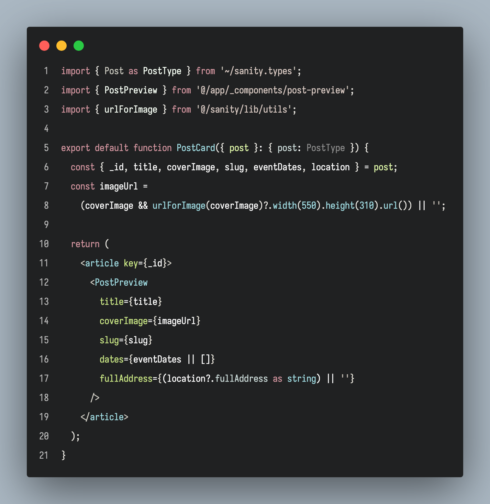

# Hyperdark (formerly 'Hypedown' Theme)

A higher contrast, yet mellow dark theme for VS Code with a mix of muted colors and highlights to easily see the important things you want to see, while subduing ones of lesser importance.

Inspired by [Habamax Theme](https://marketplace.visualstudio.com/items?itemName=codelogix.habamax) which was a vim theme I used generously.

## Preview Image

## Feedback & Contributions

Please feel free to open a PR if you find any outstanding issues. Suggestions with screenshots are welcome.

If you enjoy the theme, leaving a review and/or rating on the Marketplace genuinely helps with visibility.

Thanks :~)
